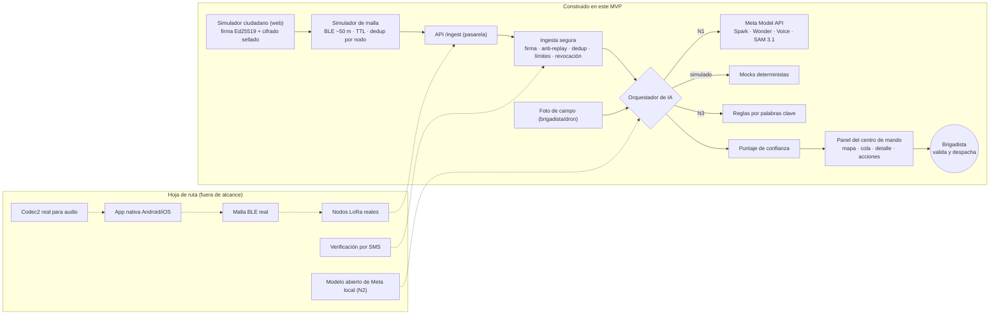

# Solaris

Plataforma de **coordinación y priorización de pedidos de ayuda (SOS)** para las **primeras 72 horas después de un desastre**, cuando la información y los recursos están desorganizados. Proyecto de la *Meta Global AI Developer Hackathon* (track Indie Developer, tema "Build for Your World").

> **Solaris no diagnostica ni da consejos médicos.** Es una herramienta de coordinación de recursos para rescatistas. La IA propone; **cada validación, asignación y despacho lo decide una persona**.

## El problema

Tras un sismo, los pedidos de ayuda llegan por canales caóticos: llamadas saturadas, mensajes duplicados, audios, rumores y reportes falsos. El centro de mando no sabe a quién atender primero ni cómo repartir los equipos, y la infraestructura (internet, celdas) suele fallar justo cuando más se necesita.

## Qué hace Solaris

1. **Ciudadano:** envía un SOS con botones grandes (máx. 3 toques) y un audio opcional de hasta 15 s. El celular lo **firma (Ed25519) y lo cifra** hacia la llave pública del centro de mando.
2. **Transporte:** el paquete salta de teléfono en teléfono por Bluetooth (y troncal LoRa) hasta una pasarela. Los teléfonos puente **no pueden leer** el contenido.
3. **Ingesta segura:** el centro verifica firma, descifra, bloquea repeticiones y duplicados, limita por identidad y respeta una lista de revocación.
4. **IA en 3 niveles:** Meta Model API → (hoja de ruta: modelo abierto local) → **reglas por palabras clave** que siempre funcionan, sin internet.
5. **Decisión:** mapa, cola priorizada, **puntaje de confianza** con desglose, recomendación de asignación de equipos, validación del brigadista y despacho.

## Demo (sin credenciales)

```bash
npm install
npm run dev          # http://localhost:3000
```

| Ruta | Qué muestra |
|---|---|
| `/centro` | Panel del centro de mando. Botón **Cargar escenario Cali 2026**, **Benchmark 100 SOS**, **Simular caída de internet**, **Recomendar asignación**. |
| `/ciudadano` | Simulador mobile-first: genera paquetes **reales** firmados y cifrados (179 bytes por SOS de botones). |
| `/malla` | Simulación visual de la malla Bluetooth: alcance, TTL, deduplicación por nodo, permiso de retransmisión. |

Guion sugerido (2 min): cargar el escenario → ver cola y mapa → abrir el SOS falso (confianza baja, **no descartado**, marcado para revisión) → ver las defensas activas (replay, firma inválida, ráfaga, identidad revocada) → "Simular caída de internet" y reenviar → "Recomendar asignación" y aceptar/rechazar → subir una foto de campo.

### Comandos

```bash
npm run dev        # servidor de desarrollo
npm run test       # Vitest (58 pruebas)
npm run keys       # genera el par de llaves del centro (-- --write las guarda en .env.local)
npm run scenario   # corre el escenario Cali 2026 en proceso + benchmark, sin servidor
npm run build      # build de producción
```

Todo funciona **sin ninguna credencial**: sin `META_API_KEY` la IA corre en modo **simulado** (determinista); sin llaves del centro se genera un par efímero en memoria.

## Modelos de Meta y para qué se usan

| Modelo | Uso en Solaris | Cuándo se llama |
|---|---|---|
| **Muse Spark** (`muse-spark-1.3`) | Triage por SOS: tipo, personas, vulnerables, atrapamiento, prioridad P1–P4 y justificación corta para el rescatista. Salida JSON validada con Zod. | Una vez por SOS (barato). |
| **Muse Voice Transcribe 1.0** | Transcribe el audio del SOS con sesgo por palabras clave de emergencia. | Solo si hay audio. |
| **Muse Wonder** (`muse-wonder-1.0`) | Analista del centro: propone la asignación de equipos a todos los casos activos (JSON schema). | **Solo bajo demanda** (botón); es caro. |
| **SAM 3.1** | Segmenta "persona", "estructura colapsada", "vía bloqueada" en fotos de brigadistas; el resultado **alimenta la confianza y la prioridad** del caso. | Al subir una foto. |

Cada modelo está detrás de una interfaz (`TranscriptionProvider`, `TriageProvider`, `AnalystProvider`, `VisionProvider`) con implementación `meta` y `mock`. El indicador visible en el panel muestra `IA: META API`, `IA: SIMULADA` o `SIN INTERNET: REGLAS`. Si una llamada falla, no valida o devuelve lenguaje médico, el sistema **cae a reglas y sigue funcionando**. Detalle de supuestos en [`docs/ASSUMPTIONS.md`](docs/ASSUMPTIONS.md).

## Confianza y SOS falsos

Puntaje 0–100 con desglose visible: firma/identidad, evento sísmico activo (tiempo y espacio), otros SOS cercanos, proximidad de los nodos que retransmitieron (el alcance Bluetooth corrobora la ubicación), coherencia del contenido y evidencia de foto de campo. **Regla ética:** un SOS de baja confianza **nunca se descarta**; solo baja un nivel de prioridad y queda marcado para revisión humana.

## Arquitectura



| Componente | Estado |
|---|---|
| Panel del centro de mando, ingesta segura, triage, confianza, recomendación, fotos | **Real** (IA detrás de adaptador con mock) |
| App del ciudadano | **Simulador web** que genera paquetes reales |
| Malla Bluetooth / LoRa | **Simulación visual** |
| App nativa, malla BLE real, LoRa real, SMS, modelo local N2, Codec2 | **Hoja de ruta** |

## Paquete SOS

Encabezado en claro de 24 bytes (versión, urgencia, TTL, banderas, ID aleatorio de 16 bytes, timestamp) + cuerpo cifrado con `crypto_box_seal` que contiene llave pública del remitente, firma Ed25519 y datos del SOS. La firma cubre el encabezado (con el TTL en cero, porque los relevos lo decrementan), la llave del remitente y el contenido. **Un SOS de botones ocupa 179 bytes (límite 240).** El audio viaja en mensajes aparte y fragmentados; en el simulador el audio no se comprime con Codec2 (solo se muestra el tamaño teórico a ~1.200 bps).

## Stack

Next.js (App Router) + TypeScript, Leaflet + OpenStreetMap (sin API key, tiles en escala de grises), `libsodium-wrappers`, Zod, Vitest. Datos detrás de una interfaz `Repository` (memoria por defecto; esquema Postgres/Supabase en [`supabase/schema.sql`](supabase/schema.sql)). Todos los tokens de diseño están en `src/styles/tokens.css` para aplicar un design system después sin reescribir componentes.

## Variables de entorno

Ver [`.env.example`](.env.example). **Nunca** subas `.env.local`: el repositorio es público.

## Construido durante la hackathon

Todo el código de este repositorio se escribió entre el 27 de octubre y el 4 de noviembre de 2026 (el historial de commits es la prueba): paquete SOS y criptografía, ingesta segura, adaptadores de IA y motor de reglas, puntaje de confianza, panel, simuladores, escenario y benchmark, flujo de fotos y documentación.

## Concepto previo

La idea de Solaris proviene de una propuesta presentada en un rally de innovación. De esa propuesta solo se toma el concepto; **no se reutiliza código**: la implementación es 100 % nueva.

## Documentación

- [`docs/ASSUMPTIONS.md`](docs/ASSUMPTIONS.md): supuestos y puntos `VERIFICAR`.
- [`docs/THREAT_MODEL.md`](docs/THREAT_MODEL.md): amenazas y mitigaciones.

## Licencia

Apache 2.0 (ver [`LICENSE`](LICENSE)).
