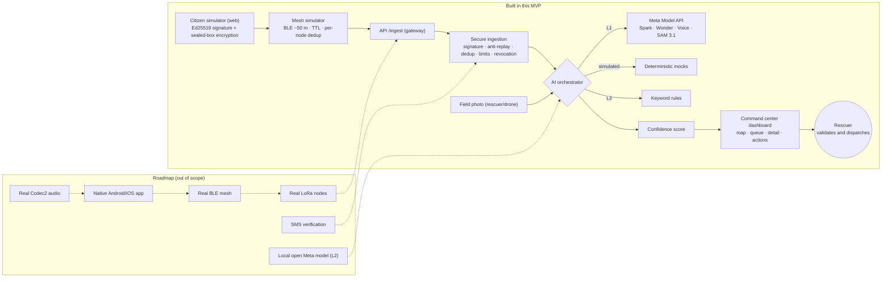

# Solaris

A platform for **coordinating and prioritizing help requests (SOS) during the first 72 hours after a disaster**, when information and resources are disorganized. Built for the *Meta Global AI Developer Hackathon* (Indie Developer track, theme "Build for Your World").

> **Solaris does not diagnose or give medical advice.** It is a resource-coordination tool for rescuers. The AI proposes; **every validation, assignment and dispatch is decided by a human**.

## The problem

After an earthquake, help requests arrive through chaotic channels: saturated phone lines, duplicated messages, audio clips, rumors and false reports. The command center does not know whom to attend first or how to distribute rescue teams, and infrastructure (internet, cell towers) often fails exactly when it is needed most.

## What Solaris does

1. **Citizen:** sends an SOS with big buttons (3 taps max) and an optional audio clip of up to 15 s. The phone **signs (Ed25519) and encrypts** the message towards the command center's public key.
2. **Transport:** the packet hops from phone to phone over Bluetooth (plus an optional LoRa trunk) to a gateway. Relay phones **cannot read** the content.
3. **Secure ingestion:** the center verifies the signature, decrypts, blocks replays and duplicates, rate-limits per identity and honors a revocation list.
4. **Three AI levels:** Meta Model API → (roadmap: local open Meta model) → **keyword rules** that always work, with no internet.
5. **Decision:** map, prioritized queue, **confidence score** with breakdown, resource-assignment recommendation, rescuer validation and dispatch.

## Demo (no credentials needed)

```bash
npm install
npm run dev          # http://localhost:3000
```

| Route | What it shows |
|---|---|
| `/command-center` | Command center dashboard. Buttons: **Load Cali 2026 scenario**, **Benchmark 100 SOS**, **Simulate internet outage**, **Recommend assignment**. |
| `/citizen` | Mobile-first citizen simulator: generates **real** signed and encrypted packets (179 bytes per button-only SOS). |
| `/mesh` | Visual simulation of the Bluetooth mesh: range, TTL, per-node deduplication, relay permission. |

Suggested 2-minute walkthrough: load the scenario → look at the queue and map → open the false SOS (low confidence, **not discarded**, flagged for review) → look at the active defenses (replay, invalid signature, burst, revoked identity) → "Simulate internet outage" and send another SOS → "Recommend assignment" and accept/reject → upload a field photo.

### Commands

```bash
npm run dev        # development server
npm run test       # Vitest
npm run keys       # generates the command center key pair (-- --write saves it to .env.local)
npm run scenario   # runs the Cali 2026 scenario in-process + benchmark, no server needed
npm run build      # production build
```

Everything works **with no credentials**: without `META_API_KEY` the AI runs in deterministic **simulated** mode; without command center keys an ephemeral in-memory pair is generated.

## Meta models used and why

| Model | Use in Solaris | When it is called |
|---|---|---|
| **Muse Spark** (`muse-spark-1.3`) | Per-SOS triage: type, people, vulnerable groups, entrapment, priority P1–P4 and a short rescuer-oriented justification. JSON output validated with Zod. | Once per SOS (cheap). |
| **Muse Voice Transcribe 1.0** | Transcribes the SOS audio with keyword biasing towards emergency vocabulary. | Only if there is audio. |
| **Muse Wonder** (`muse-wonder-1.0`) | Command center analyst: proposes team assignments for all active cases (JSON schema). | **On demand only** (button); it is the expensive one. |
| **SAM 3.1** | Segments "person", "collapsed structure", "blocked road" in rescuer photos; the result **feeds the case's confidence and priority**. | When a photo is uploaded. |

Each model sits behind an interface (`TranscriptionProvider`, `TriageProvider`, `AnalystProvider`, `VisionProvider`) with a `meta` and a `mock` implementation. A visible indicator in the dashboard shows `AI: META API`, `AI: SIMULATED` or `OFFLINE: RULES`. If a call fails, does not validate or returns medical language, the system **falls back to rules and keeps working**. Details in [`docs/ASSUMPTIONS.md`](docs/ASSUMPTIONS.md).

## Confidence and false SOS

A 0–100 score with a visible breakdown: signature/identity, active seismic event (time and space), other nearby SOS, proximity of the nodes that relayed the message (Bluetooth range corroborates the reported location), content coherence and field-photo evidence. **Ethical rule:** a low-confidence SOS is **never discarded**; it only drops one priority level and is flagged for human review.

## Architecture



| Component | Status |
|---|---|
| Command center dashboard, secure ingestion, triage, confidence, recommendation, photos | **Real** (AI behind an adapter with a mock) |
| Citizen app | **Web simulator** that generates real packets |
| Bluetooth / LoRa mesh | **Visual simulation** |
| Native app, real BLE mesh, real LoRa, SMS, local L2 model, Codec2 | **Roadmap** |

## SOS packet

A 24-byte clear header (version, urgency, TTL, flags, 16-byte random ID, timestamp) + a body sealed with `crypto_box_seal` containing the sender's public key, an Ed25519 signature and the SOS data. The signature covers the header (with TTL zeroed, because relays decrement it), the sender key and the content. **A button-only SOS is 179 bytes (limit 240).** Audio travels in separate, fragmented messages; in the simulator audio is not Codec2-compressed (only the theoretical size at ~1,200 bps is shown).

## Stack

Next.js (App Router) + TypeScript, Leaflet + OpenStreetMap (no API key, grayscale tiles), `libsodium-wrappers`, Zod, Vitest. Data sits behind a `Repository` interface (in-memory by default; Postgres/Supabase schema in [`supabase/schema.sql`](supabase/schema.sql)). All design tokens live in `src/styles/tokens.css` so a design system can be applied later without rewriting components.

## Environment variables

See [`.env.example`](.env.example). **Never** commit `.env.local`: the repository is public.

## Built during the hackathon

All code in this repository was written between October 27 and November 4, 2026 (the commit history is the proof): SOS packet and cryptography, secure ingestion, AI adapters and rules engine, confidence score, dashboard, simulators, scenario and benchmark, photo flow and documentation.

## Prior concept

The idea behind Solaris comes from a proposal presented at an innovation rally. Only the concept is carried over; **no code is reused**: the implementation is 100% new.

## Documentation

- [`docs/ASSUMPTIONS.md`](docs/ASSUMPTIONS.md): assumptions and `VERIFY` items.
- [`docs/THREAT_MODEL.md`](docs/THREAT_MODEL.md): threats and mitigations.

## Language note

The code, documentation and UI are in English. The demo scenario's citizen messages are intentionally in **Spanish** (they model real SOS from Cali, Colombia), and the rules engine understands both Spanish and English keywords.

## License

Apache 2.0 (see [`LICENSE`](LICENSE)).
